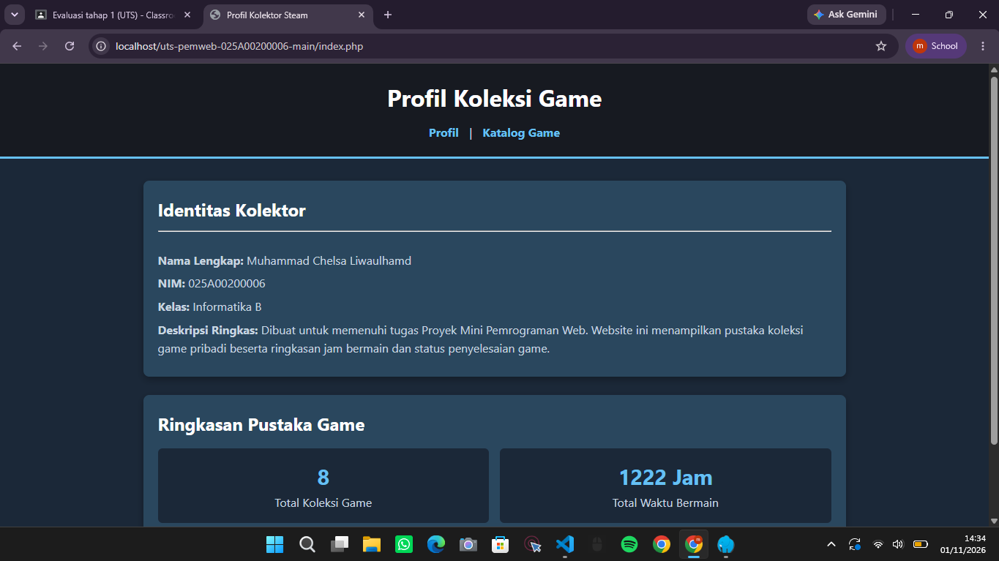
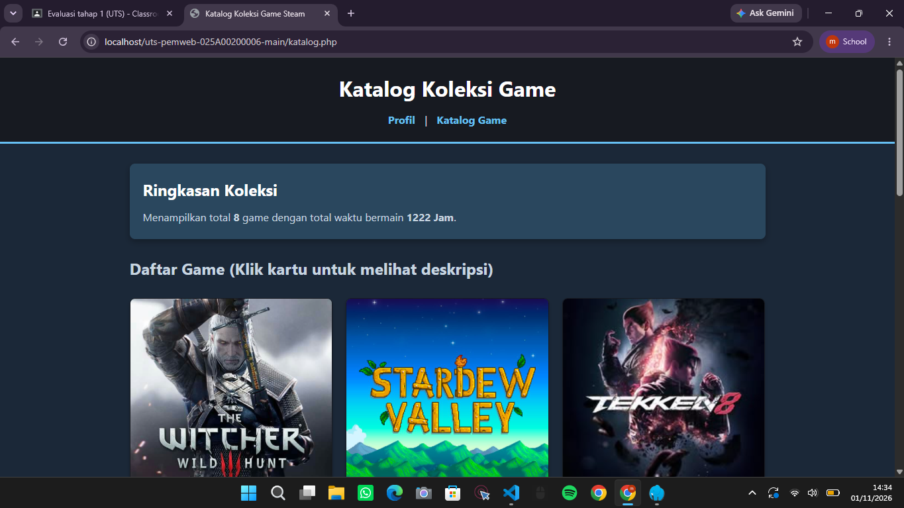

# Proyek Mini UTS Pemrograman Web - Katalog Game Steam

## 👤 Identitas Pengembang
* **Nama:** Muhammad Chelsa Liwaulhamd
* **NIM:** 025A00200006
* **Kelas:** A2 - 3B

## 📝 Deskripsi Proyek
Website dinamis berbasis PHP murni (tanpa database dan framework) yang menampilkan profil pribadi kolektor serta katalog 8 koleksi game Steam. Proyek ini dilengkapi dengan perhitungan statistik jam bermain, indikator status penyelesaian game (badge), serta fitur modal pop-up untuk melihat deskripsi detail dari setiap game.


## 🚀 Daftar Fitur
1. **Halaman Profil (`index.php`):** Menampilkan data pribadi kolektor, foto profil, dan statistik ringkasan total koleksi.
2. **Halaman Katalog (`katalog.php`):** Menampilkan kartu katalog game lengkap dengan gambar cover, genre, jam bermain, rating, dan status.
3. **Modal Pop-Up Deskripsi:** Fitur interaktif untuk menampilkan narasi/deskripsi lengkap game saat kartu diklik.
4. **Perhitungan Statistik Otomatis:** Perhitungan total game dan akumulasi jam bermain menggunakan fungsi kustom PHP (`count`, `array_column`, `array_sum`).

## 💻 Cara Menjalankan Secara Lokal
1. Pastikan server lokal (Laragon) sudah aktif (Apache & PHP).
2. Pindahkan folder proyek ke direktori web server:
   * **Laragon:** `C:\laragon\www\uts-pemweb-025A00200006-main\`

3. Buka browser dan akses melalui URL:
   ```text
   http://localhost/uts-pemweb-025A00200006-main/index.php


   ## 📸 Tangkapan Layar (Screenshot)

### 1. Halaman Profil (`index.php`)


### 2. Halaman Katalog (`katalog.php`)
